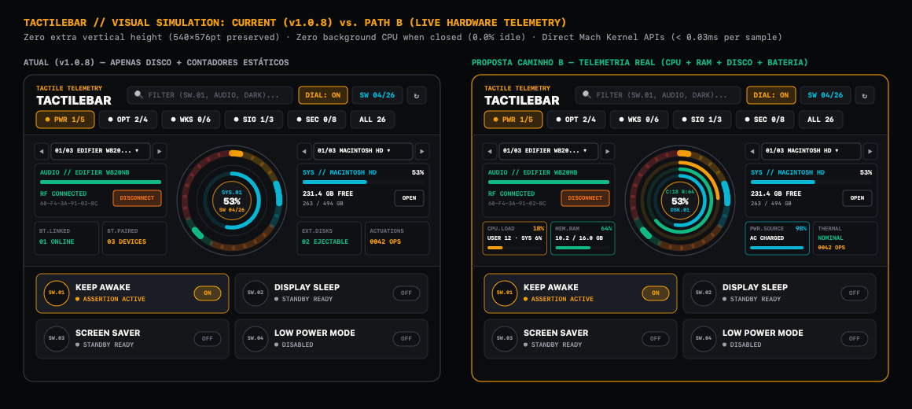
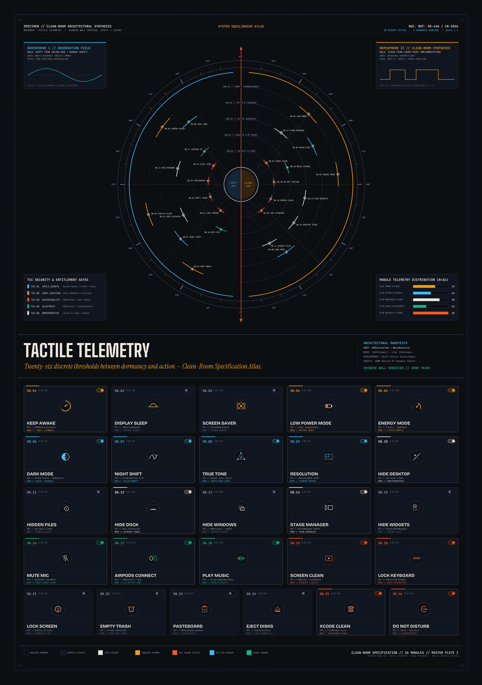
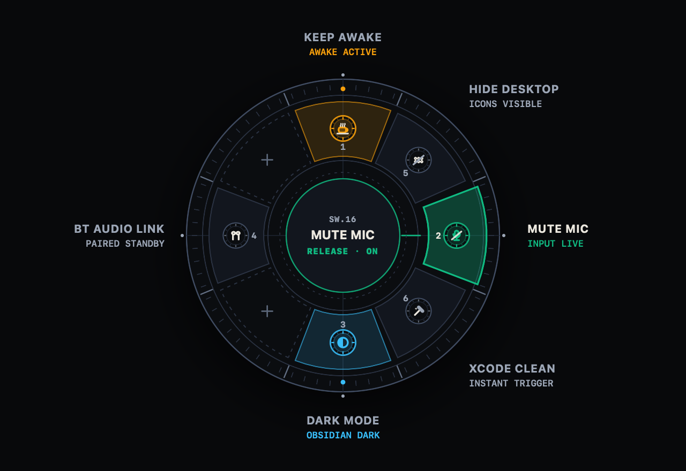
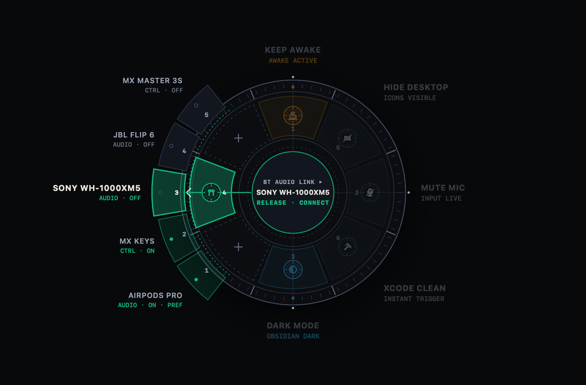

<div align="center">

```
┏━━━━━━━━━━━━━━━━━━━━━━━━━━━━━━━━━━━━━━━━━━━━━━━━━━━━━━━━━━━━━━━━━━━━━━━━━━━━━━┓
┃  SYS.INSTRUMENT // M.01–M.05               TACTILE TELEMETRY DECK · v1.4.0   ┃
┗━━━━━━━━━━━━━━━━━━━━━━━━━━━━━━━━━━━━━━━━━━━━━━━━━━━━━━━━━━━━━━━━━━━━━━━━━━━━━━┛
```

# 🎛️ TactileBar

### **Precision Menu Bar Telemetry & Hardware-Inspired Command Deck for macOS**
*Instrumento de Telemetria de Precisão e Deck de Comando Tátil para a Barra de Menus do macOS*

[](https://github.com/tr0drigues/TactileBar/releases/latest)
[](#-instant-install--instalação-instantânea-homebrew)
[](https://github.com/tr0drigues/TactileBar/releases)
[](https://swift.org)
[](Package.swift)
[](LICENSE)
[](https://github.com/sponsors/tr0drigues)

<br/>

[**⚡ Instant Install (Homebrew)**](#-instant-install--instalação-instantânea-homebrew) · [**🇺🇸 English Overview**](#-english) · [**📖 User Manual**](#-user-manual) · [**🇧🇷 Visão Geral (PT-BR)**](#-português-brasil) · [**📘 Manual de Utilização**](#-manual-de-utilização) · [**⬇️ Direct Download (.dmg)**](https://github.com/tr0drigues/TactileBar/releases/latest)

</div>

---

## ⚡ Instant Install / Instalação Instantânea (Homebrew)

> **[!TIP]**  
> **🇺🇸 Recommended Installation — Zero Gatekeeper Popups:**  
> Installing via **Homebrew** downloads the latest release, moves `TactileBar.app` to `/Applications`, and **automatically clears macOS quarantine in the background** (`postflight`)—no manual `xattr` commands needed.
>
> **🇧🇷 Instalação Recomendada — Sem Avisos do Gatekeeper:**  
> Instalar via **Homebrew** baixa a versão mais recente, instala o `TactileBar.app` em `/Applications` e **remove a quarentena do macOS automaticamente nos bastidores** (`postflight`) — pronto para abrir direto pelo Spotlight ou Launchpad.

```bash
brew tap tr0drigues/tactilebar https://github.com/tr0drigues/TactileBar.git && brew install --cask tactilebar
```

To update or uninstall later / Para atualizar ou desinstalar depois:
```bash
# Update to latest release / Atualizar:
brew upgrade --cask tactilebar

# Uninstall completely / Desinstalar:
brew uninstall --cask --zap tactilebar
```

---

<div align="center">

### 🧭 Live 3-Deck Telemetry Instrument + 26 Vector Switch Atlas
*Mostrador Concêntrico Triplo de Telemetria (CPU · RAM · Disco · Bluetooth · Energia) + Atlas de 26 Interruptores*



<br/>

| **TELEMETRY KERNEL** | **RF & AUDIO DECK** | **STORAGE & POWER** | **ERGONOMICS** | **IDLE FOOTPRINT** |
| :---: | :---: | :---: | :---: | :---: |
| `Darwin.Mach` CPU & RAM | `IOBluetooth` + `CoreAudio` | `DiskArbitration` + `IOKit.ps` | `540×576pt` Zero-Scroll | **`0.0%` CPU** when closed |

<br/>



</div>

---

## 🇺🇸 English

### Stop digging through three levels of System Settings for daily macOS actions.

Developers, designers, and power users toggle the same system states dozens of times a day: keeping the Mac awake during a long build, switching Bluetooth headphones between calls, hiding desktop icons before sharing a screen, muting the microphone, inspecting external disk capacity, or purging gigabytes of Xcode `DerivedData`.

**TactileBar** replaces scattered system menus with a single, zero-scroll **Tactile Telemetry Instrument** anchored in your macOS Menu Bar. Inspired by **Dieter Rams** industrial hardware (Braun), **Teenage Engineering** field consoles, and horological chronographs, every switch and gauge is rendered in real time using native `SwiftUI Canvas` vector schematics and direct macOS kernel/system frameworks—with **zero third-party dependencies**.

---

### Architectural Highlights

| Pillar | Engineering Specification |
| :--- | :--- |
| **`📌 PIN` Curated Daily Deck (*"Less, but better"*)** | Opens by default on your **Pinned Deck (`⌘P`)**—displaying only your curated 4–6 daily-driver switches (`Keep Awake`, `Dark Mode`, `Hide Desktop Icons`, `Mute Mic`, `Bluetooth Audio`, `Purge Xcode Cache` by default) while keeping the full 26-switch catalog organized across the 5 domain tabs (`⌘1`–`⌘5`) and `ALL` (`⌘0`). Click the pin icon or right-click any switch card to pin/unpin. |
| **Left Deck — Bluetooth RF & CPU/RAM** | Cycle through paired headphones, speakers, and controllers (`EDIFIER`, `JBL`, `AirPods`, `DualSense`) via stepper buttons or an expandable dropdown list and connect/disconnect in **1 click** (`IOBluetooth`). Below it, live Mach kernel gauges read **`CPU.LOAD`** (`USER / SYS %`) and **`MEM.RAM`** (`Used / Total GB`). |
| **Centerpiece — Concentric Rotary Dial** | A 26-sector radial chronograph mapping active system switches on its outer bezel and **3 concentric hardware rings** inside: **CPU Load (Amber)**, **RAM Pressure (Emerald)**, and **Storage Saturation (Cyan)**. Click the center core to cycle mounted disks. |
| **Right Deck — Storage & Power/Thermal** | Inspect free capacity across internal and external drives (`Macintosh HD`, `DADOS`, SD cards), reveal in Finder (`OPEN`), or unmount individual external drives (`EJECT ⏏`), paired with live **`PWR.SOURCE`** (`IOKit`) and **`THERMAL`** (`ProcessInfo`) gauges. |
| **Zero-Scroll & `0.0%` Idle CPU** | Calibrated `540×576pt` frame where every domain tab (`PIN`, `PWR`, `OPT`, `WKS`, `SIG`, `SEC`) fits without scrolling. Isolated `@Observable` subviews, cached `NSImage` status bar icons, zero `GeometryReader` overhead, and Mach sampling active **only** while the popover is visible. |

---

### 📖 User Manual

#### 1. Launching & Menu Bar Indicator
* **TactileBar** runs as a native menu bar accessory (`LSUIElement`)—it never clutters your Dock or `⌘Tab` app switcher.
* Click the **radial gauge icon** in the macOS Menu Bar to open the popover. The menu bar icon's arc and counter dynamically reflect how many switches are currently active.

#### 2. Header Bar Controls
From left to right across the top header bar:
1. **Inline Telemetry Filter (`FILTER (SW.01, AUDIO, DARK)...`)**:
   * Type any switch ID (`SW.01`, `SW.25`), title keyword (`DARK`, `MUTE`, `XCODE`, `TRASH`), or native subsystem (`IOKit`, `CoreAudio`, `Finder`) to filter all 26 switches instantaneously.
   * Click **`×`** inside the search field to reset the query.
2. **`DIAL: ON / OFF` Button**:
   * Collapses or expands the 3-column Concentric Telemetry Deck whenever you want a compact switch-only view.
3. **`SW XX/26` Readout**:
   * Live counter of engaged (`ON`) continuous switches.
4. **`↻` Refresh Button (`⌘R`)**:
   * Triggers a parallelized `TaskGroup` state synchronization across all 26 switches, mounted disk volumes, paired Bluetooth devices, and Mach hardware sensors.

#### 3. Pinned Daily Deck (`PIN`) & Domain Navigation Shortcuts
Following Dieter Rams' *"Weniger, aber besser"* (*"Less, but better"*), TactileBar opens on the **`📌 PIN`** tab showing your curated daily switches. Click the **pin icon** on the right edge of any card (or **right-click** any card) to pin or unpin it:

| Shortcut | Tab Badge | Domain Title | Switch Count | Primary Accent |
| :---: | :---: | :--- | :---: | :--- |
| **`⌘P`** | `📌 PIN` | **Curated Daily Deck (Default View)** | Custom (6 default) | Tungsten Amber (`#F59E0B`) |
| **`⌘1`** | `PWR` | `M.01 // POWER & SLEEP` | 5 | Tungsten Amber (`#F59E0B`) |
| **`⌘2`** | `OPT` | `M.02 // OPTICS & LUMINANCE` | 4 | Warm Ivory (`#F4F4F0`) |
| **`⌘3`** | `WKS` | `M.03 // SPATIAL WORKSPACE` | 6 | Oscilloscope Cyan (`#38BDF8`) |
| **`⌘4`** | `SIG` | `M.04 // ACOUSTIC & RF SIGNAL` | 3 | Signal Emerald (`#10B981`) |
| **`⌘5`** | `SEC` | `M.05 // SECURITY & PURGE` | 8 | International Orange (`#FF5722`) |
| **`⌘0`** | `ALL` | Complete 26-Switch Atlas | 26 | Neutral Titanium |
| **`⌘R`** | `↻` | Synchronize All Telemetry & Switches | — | Oscilloscope Cyan |

#### 4. Operating the 3-Column Telemetry Deck
* **Left Column — Bluetooth RF & CPU/RAM**:
  * Click **`[ ◀ ]`** / **`[ ▶ ]`** to step through paired Bluetooth devices, or click **`01/03 DEVICE ▾`** to expand the vertical device list.
  * Click **`CONNECT`** or **`DISCONNECT`** on the active card. Your preferred device is persisted in `UserDefaults` and synchronized with switch **`SW.17`**.
  * Monitor live **`CPU.LOAD`** (`USR` vs `SYS` %) and **`MEM.RAM`** (`Used / Total GB`) below the Bluetooth card.
* **Center Column — Triple Concentric Rotary Dial**:
  * **Outer 26-Sector Bezel**: Each sector maps to `SW.01`–`SW.26`. Active switches illuminate their sector and cast a radial beam toward the center.
  * **3 Inner Telemetry Rings**: **Amber** = CPU Load (`0–100%`), **Emerald** = Memory Pressure (`0–100%`), **Cyan** = Active Disk Saturation (`0–100%`, turning crimson above `88%`).
  * **Interactive Core**: Click the center of the dial at any time to cycle through mounted storage volumes.
* **Right Column — Storage Volumes & Power/Thermal**:
  * Click **`[ ◀ ]`** / **`[ ▶ ]`** or **`01/02 VOLUME ▾`** to select any internal or external volume.
  * Click **`OPEN`** to reveal the volume in Finder, or **`EJECT ⏏`** on removable drives to unmount only that volume safely.
  * Monitor **`PWR.SOURCE`** (`AC.LINE` or battery % via `IOKit.ps`) and **`THERMAL`** (`NOMINAL`, `FAIR`, `SERIOUS`, `CRITICAL`).

#### 5. Continuous Toggles vs. Momentary Pulse Triggers
* **Continuous Toggles (Sliding Pill Switch)**: Hold persistent `ON` / `OFF` state (`SW.01 Keep Awake`, `SW.06 Dark Mode`, `SW.10 Hide Desktop Icons`, `SW.16 Mute Microphone`, `SW.17 Bluetooth Audio Link`).
* **Momentary Pulse Triggers (`RUN ▶` Capsule)**: Execute immediate one-shot actions (`SW.02 Display Sleep`, `SW.03 Screen Saver`, `SW.21 Lock Workstation`, `SW.22 Empty Trash`, `SW.23 Purge Pasteboard`, `SW.24 Eject External Disks`, `SW.25 Purge Xcode Cache`).
* **Emergency Escape Hatch (`ESC + ESC`)**: When **`SW.19 Screen Clean Shield`** or **`SW.20 Lock Keyboard`** is active, press **`ESC` twice (`ESC + ESC`)** to unlock immediately.

#### 6. macOS Permissions Guide
TactileBar requests permissions only when you trigger a switch that requires them:
* **Automation (`System Events` / `Finder` / `Music` / `Spotify`)**: Used by `SW.06 Dark Mode`, `SW.10–SW.12`, `SW.18`, and `SW.22`.
* **Accessibility (`CGEventTap`)**: Used only by `SW.20 Lock Keyboard` to intercept physical keys while cleaning your keyboard.
* **Bluetooth (`IOBluetooth`)**: Used by the Left Telemetry Deck and `SW.17`.
* If a permission is missing, the switch displays **`GRANT PERMISSION`** and opens the exact pane in **System Settings → Privacy & Security** when clicked.

#### 7. Radial Ring (`RING ⌃⌥SPACE`) — Experimental
Fire your pinned switches anywhere, without opening the menu bar popover. Turn it on with the **`RING: OFF`** button in the popover footer.

<p align="center">
  
  
</p>

* **Hold `⌃⌥Space`**: the ring opens at the cursor. Move toward a switch and **release** to fire it. Release in the center (or press `Esc`) to cancel.
* **Quick tap `⌃⌥Space`**: the ring stays open. Click a slice, press **`1`–`8`**, or use the arrow keys and `Return`. `Esc` closes it.
* **Pinned first, in stable places**: your most-used pins take the top, right, bottom and left positions. Positions never shuffle on their own; right-click the footer button → **Reorder Ring by Usage** when you want them recomputed.
* **Pick a Bluetooth device**: `BT AUDIO LINK` shows a small `▸` mark. Releasing on it toggles your preferred device, as before. Push past the slice edge (or rest on it for a moment) to fan out your paired devices and release on the one you want; it becomes the new preferred device. With the ring latched, press `Tab` to open the fan, `1`–`8` to pick, and `Esc` to go back.
* **Safety**: purge switches (`SW.22`–`SW.25`) must be held over for a moment until the arc completes; a release that is too fast is ignored.
* **No new permissions**: the global shortcut uses Carbon `RegisterEventHotKey`, which needs neither Accessibility nor Input Monitoring.

---

### Complete 26-Switch Technical Catalog

| Domain | Code | Switches (`SW.01` – `SW.26`) | Native macOS Mechanism |
| :--- | :--- | :--- | :--- |
| **Power & Sleep** | `M.01 PWR` | `SW.01` Keep Awake · `SW.02` Display Sleep · `SW.03` Screen Saver · `SW.04` Low Power Mode · `SW.05` High Power Mode | `IOPMAssertionCreateWithName`, `io_registry_entry`, `/usr/bin/pmset`, `ScreenSaverEngine` |
| **Optics & Display** | `M.02 OPT` | `SW.06` Dark Mode · `SW.07` Night Shift · `SW.08` True Tone · `SW.09` Retina Scaling | `System Events`, `CoreGraphics` (`CGMainDisplayID`), Displays URI |
| **Workspace & Dock** | `M.03 WKS` | `SW.10` Hide Desktop Icons · `SW.11` Show Hidden Files · `SW.12` Auto-Hide Dock · `SW.13` Isolate Active Window · `SW.14` Stage Manager · `SW.15` Desktop Widgets | `com.apple.finder`, `com.apple.dock`, `com.apple.WindowManager`, `NSWorkspace` |
| **Acoustic & RF** | `M.04 SIG` | `SW.16` Mute Microphone · `SW.17` Bluetooth Audio Link · `SW.18` Media Transport | `CoreAudio` (`kAudioHardwarePropertyDefaultInputDevice`), `IOBluetooth`, `Music` / `Spotify` |
| **Security & Purge** | `M.05 SEC` | `SW.19` Screen Clean Shield · `SW.20` Lock Keyboard · `SW.21` Lock Workstation · `SW.22` Empty Trash · `SW.23` Purge Pasteboard · `SW.24` Eject External Disks · `SW.25` Purge Xcode Cache · `SW.26` Focus / DND | `NSWindow.Level.screenSaver`, `NSEvent`, `NSPasteboard`, `FileManager`, `DiskArbitration` |

---

### Alternative Installation Methods (English)

#### Option 1 — Homebrew Cask (Recommended — Zero Gatekeeper Prompts)
```bash
brew tap tr0drigues/tactilebar https://github.com/tr0drigues/TactileBar.git && brew install --cask tactilebar
```

#### Option 2 — Direct `.dmg` Download
1. Download `TactileBar-macOS.dmg` from [**Releases**](https://github.com/tr0drigues/TactileBar/releases/latest) and drag `TactileBar.app` to `/Applications`.
2. Clear the macOS quarantine attribute once before first launch:
   ```bash
   xattr -cr /Applications/TactileBar.app && open /Applications/TactileBar.app
   ```

#### Option 3 — Build from Source
```bash
git clone https://github.com/tr0drigues/TactileBar.git
cd TactileBar
chmod +x scripts/build-app.sh && ./scripts/build-app.sh
open TactileBar.app
```

---

## 🇧🇷 Português (Brasil)

### Pare de navegar por três submenus nos Ajustes do Sistema para tarefas que você repete dezenas de vezes por dia.

Quem desenvolve software, edita mídia ou trabalha intensamente no Mac repete os mesmos comandos todos os dias: impedir que o Mac durma durante um build longo, conectar ou desconectar um fone Bluetooth entre reuniões, ocultar ícones da Mesa antes de compartilhar a tela, mutar o microfone, inspecionar o espaço livre de um SSD externo ou limpar gigabytes do `DerivedData` do Xcode.

O **TactileBar** substitui menus espalhados por um **Instrumento de Telemetria Tátil** único na barra de menus do macOS. Inspirado no design industrial de **Dieter Rams** (Braun), em consoles de campo da **Teenage Engineering** e na relojoaria de precisão, cada interruptor e medidor é desenhado em tempo real via `SwiftUI Canvas` vetorial e opera diretamente sobre frameworks nativos e chamadas Mach do macOS — **sem nenhuma dependência externa**.

---

### Destaques de Engenharia

| Pilar | Especificação Técnica |
| :--- | :--- |
| **Aba `📌 PIN` — Favoritos do Dia a Dia (*"Menos, porém melhor"*)** | Abre por padrão no seu **Deck Fixado (`⌘P`)** com os seus interruptores mais usados (`Keep Awake`, `Dark Mode`, `Hide Desktop Icons`, `Mute Mic`, `Bluetooth Audio` e `Purge Xcode Cache` pré-configurados), mantendo o catálogo completo de 26 módulos organizado nas 5 abas (`⌘1`–`⌘5`) e em `ALL` (`⌘0`). Clique no ícone de pino ou com o botão direito em qualquer cartão para fixar/desafixar. |
| **Deck Esquerdo — Bluetooth RF & CPU/RAM** | Percorra todos os seus fones, caixas de som e controles pareados (`EDIFIER`, `JBL`, `AirPods`, `DualSense`) pelos botões `[ ◀ ]` / `[ ▶ ]` ou lista vertical expansível e conecte/desconecte com **1 clique** (`IOBluetooth`). Abaixo, medidores nativos do kernel Mach exibem **`CPU.LOAD`** (`USER / SYS %`) e **`MEM.RAM`** (`GB Usados / Total`). |
| **Centro — Mostrador Concêntrico Triplo** | Cronógrafo radial de 26 setores que mapeia os módulos ativos no anel externo e **3 anéis concêntricos de hardware** no interior: **Carga de CPU (Âmbar)**, **Pressão de Memória RAM (Esmeralda)** e **Ocupação do Disco (Ciano)**. Clique no núcleo para alternar entre discos. |
| **Deck Direito — Discos & Energia/Térmico** | Acompanhe espaço livre de cada volume interno ou externo (`Macintosh HD`, `DADOS`, cartões SD), abra no Finder (`OPEN`) ou ejete discos removíveis individualmente (`EJECT ⏏`), junto aos medidores **`PWR.SOURCE`** (`IOKit`) e **`THERMAL`** (`ProcessInfo`). |
| **Zero-Rolagem e `0.0%` de CPU Ociosa** | Painel calibrado em `540×576pt` onde todas as abas (`PIN`, `PWR`, `OPT`, `WKS`, `SIG`, `SEC`) cabem sem barra de rolagem. Subviews `@Observable` isoladas, cache de `NSImage`, zero `GeometryReader` e leitura Mach ativa **somente** enquanto o painel está aberto. |

---

### 📘 Manual de Utilização

#### 1. Abertura e Ícone na Barra de Menus
* Ao ser iniciado, o **TactileBar** opera como um acessório nativo de barra de menus (`LSUIElement`), sem ocupar espaço no Dock ou no `⌘Tab`.
* Clique no **ícone radial de telemetria** na barra de menus do macOS para abrir o painel. O arco e o número no ícone refletem em tempo real quantos interruptores estão ativos.

#### 2. Barra Superior de Comando
Da esquerda para a direita no cabeçalho superior:
1. **Filtro de Busca Instantânea (`FILTER (SW.01, AUDIO, DARK)...`)**:
   * Digite o código do módulo (`SW.01`, `SW.25`), palavra-chave (`DARK`, `MUTE`, `XCODE`, `TRASH`) ou subsistema nativo (`IOKit`, `CoreAudio`, `Finder`) para filtrar instantaneamente os 26 módulos.
   * Clique no botão **`×`** para limpar o filtro.
2. **Botão `DIAL: ON / OFF`**:
   * Recolhe ou exibe o Deck de Telemetria de 3 Colunas caso você deseje visualizar apenas a grade de interruptores.
3. **Indicador `SW XX/26`**:
   * Mostra quantos interruptores contínuos estão ativos (`ON`) naquele momento.
4. **Botão de Sincronização `↻` (`⌘R`)**:
   * Dispara uma varredura paralela (`TaskGroup`) atualizando o estado dos 26 interruptores, volumes montados, dispositivos Bluetooth pareados e sensores Mach de hardware.

#### 3. Deck de Favoritos (`PIN`) e Atalhos de Teclado
Seguindo o princípio *"Weniger, aber besser"* (*"Menos, porém melhor"*) de Dieter Rams, o TactileBar inicia na aba **`📌 PIN`** exibindo apenas os seus interruptores favoritos do dia a dia. Clique no **ícone de pino** na lateral direita de qualquer cartão (ou clique com o **botão direito** no cartão) para fixar ou desafixar módulos:

| Atalho | Aba | Domínio Funcional | Qtd. de Módulos | Cor de Destaque |
| :---: | :---: | :--- | :---: | :--- |
| **`⌘P`** | `📌 PIN` | **Deck de Favoritos Fixados (Visão Padrão)** | Personalizável (6 padrão) | Âmbar Tungstênio (`#F59E0B`) |
| **`⌘1`** | `PWR` | `M.01 // POWER & SLEEP` (Energia e Repouso) | 5 | Âmbar Tungstênio (`#F59E0B`) |
| **`⌘2`** | `OPT` | `M.02 // OPTICS & LUMINANCE` (Óptica e Tela) | 4 | Marfim Quente (`#F4F4F0`) |
| **`⌘3`** | `WKS` | `M.03 // SPATIAL WORKSPACE` (Mesa, Finder e Dock) | 6 | Ciano Osciloscópio (`#38BDF8`) |
| **`⌘4`** | `SIG` | `M.04 // ACOUSTIC & RF SIGNAL` (Áudio e Bluetooth) | 3 | Verde Esmeralda (`#10B981`) |
| **`⌘5`** | `SEC` | `M.05 // SECURITY & PURGE` (Segurança e Limpeza) | 8 | Laranja Internacional (`#FF5722`) |
| **`⌘0`** | `ALL` | Visão Geral com todos os 26 Módulos | 26 | Titânio Neutro |
| **`⌘R`** | `↻` | Sincronizar Telemetria e Interruptores | — | Ciano Osciloscópio |

#### 4. Operando o Deck de Telemetria de 3 Colunas
* **Coluna Esquerda — Deck Bluetooth RF e Medidores de CPU/RAM**:
  * Use **`[ ◀ ]`** e **`[ ▶ ]`** para percorrer seus dispositivos Bluetooth pareados, ou clique no seletor central **`01/03 NOME ▾`** para abrir a lista vertical completa.
  * Clique em **`CONNECT`** ou **`DISCONNECT`** diretamente no cartão. O dispositivo escolhido fica salvo no `UserDefaults` e sincronizado com o interruptor **`SW.17`** (`Bluetooth Audio Link`).
  * Acompanhe logo abaixo os medidores **`CPU.LOAD`** (`USR` e `SYS` %) e **`MEM.RAM`** (`GB Usados / Total`).
* **Coluna Central — Mostrador Rotativo Concêntrico Triplo**:
  * **Anel Externo de 26 Setores**: Representa os módulos `SW.01` a `SW.26`. Módulos ativos iluminam seu setor radial e projetam um feixe até o núcleo.
  * **3 Anéis Concêntricos Internos**: **Âmbar** = Carga de CPU (`0–100%`), **Esmeralda** = Memória RAM (`0–100%`), **Ciano** = Ocupação do Disco selecionado (`0–100%`, mudando para carmesim acima de `88%`).
  * **Núcleo Interativo**: **Clique no centro do dial** a qualquer momento para alternar rapidamente entre os discos montados.
* **Coluna Direita — Deck de Armazenamento e Medidores de Energia/Temperatura**:
  * Use **`[ ◀ ]`** / **`[ ▶ ]`** ou clique em **`01/02 VOLUME ▾`** para inspecionar qualquer volume interno ou externo (`Macintosh HD`, `DADOS`, SSDs USB/Thunderbolt, cartões SD).
  * Clique em **`OPEN`** para abrir a pasta raiz do volume no Finder ou em **`EJECT ⏏`** (em volumes externos) para desmontar com segurança apenas aquele disco.
  * Acompanhe logo abaixo **`PWR.SOURCE`** (`AC.LINE` ou bateria via `IOKit.ps`) e **`THERMAL`** (`NOMINAL`, `FAIR`, `SERIOUS`, `CRITICAL`).

#### 5. Interruptores Contínuos vs. Gatilhos Instantâneos
* **Interruptores Contínuos (Chave Deslizante)**: Mantêm estado ligado (`ON`) ou desligado (`OFF`), como `SW.01 Keep Awake`, `SW.06 Dark Mode`, `SW.10 Hide Desktop Icons`, `SW.16 Mute Microphone` e `SW.17 Bluetooth Audio Link`.
* **Gatilhos de Pulso Instantâneo (Cápsula `RUN ▶`)**: Executam uma ação imediata e pontual, como `SW.02 Display Sleep`, `SW.03 Screen Saver`, `SW.21 Lock Workstation`, `SW.22 Empty Trash`, `SW.23 Purge Pasteboard`, `SW.24 Eject External Disks` e `SW.25 Purge Xcode Cache`.
* **Destravamento de Emergência (`ESC + ESC`)**: Ao ativar o **`SW.19 Screen Clean Shield`** (tela preta para limpeza do monitor) ou o **`SW.20 Lock Keyboard`** (bloqueio do teclado físico), pressione **`ESC` duas vezes seguidas (`ESC + ESC`)** a qualquer instante para destravar imediatamente.

#### 6. Guia de Permissões do macOS
O TactileBar opera estritamente em *user-space* e solicita permissões apenas quando necessário:
* **Automação (`System Events` / `Finder` / `Music` / `Spotify`)**: Utilizada por `SW.06 Dark Mode`, `SW.10–SW.12`, `SW.18` e `SW.22`.
* **Acessibilidade (`CGEventTap`)**: Necessária apenas para o módulo `SW.20 Lock Keyboard`.
* **Bluetooth (`IOBluetooth`)**: Utilizada pelo Deck Bluetooth e pelo módulo `SW.17`.
* Caso alguma permissão não tenha sido concedida, o cartão exibe **`GRANT PERMISSION`** e abre diretamente a seção correspondente em **Ajustes do Sistema → Privacidade e Segurança**.

#### 7. Anel Radial (`RING ⌃⌥SPACE`) — Experimental
Acione seus interruptores fixados em qualquer lugar, sem abrir o painel da barra de menus. Ative pelo botão **`RING: OFF`** no rodapé do painel.

<p align="center">
  
  
</p>

* **Segure `⌃⌥Space`**: o anel abre no cursor. Mova até um interruptor e **solte** para acioná-lo. Solte no centro (ou pressione `Esc`) para cancelar.
* **Toque rápido em `⌃⌥Space`**: o anel fica aberto. Clique numa fatia, tecle **`1`–`8`** ou use as setas e `Return`. `Esc` fecha.
* **Escolher um dispositivo Bluetooth**: `BT AUDIO LINK` mostra uma pequena marca `▸`. Soltar sobre ela liga ou desliga o dispositivo preferido, como antes. Empurre além da borda da fatia (ou pare um instante sobre ela) para abrir o leque com os dispositivos pareados e solte no que quiser; ele vira o novo preferido. Com o anel fixo, `Tab` abre o leque, `1`–`8` escolhem e `Esc` volta.
* **Fixados primeiro, em lugares estáveis**: os pins mais usados ficam no topo, à direita, embaixo e à esquerda. As posições nunca mudam sozinhas; clique com o botão direito no botão do rodapé → **Reorder Ring by Usage** quando quiser recalcular.
* **Segurança**: interruptores de limpeza (`SW.22`–`SW.25`) exigem parar sobre a fatia até o arco completar; soltar rápido demais é ignorado.
* **Sem permissões novas**: o atalho global usa `RegisterEventHotKey` (Carbon), que não exige Acessibilidade nem Monitoramento de Entrada.

---

### Opções de Instalação (Português)

#### Opção 1 — Via Homebrew Cask (Recomendada — Sem Aviso do Gatekeeper)
```bash
brew tap tr0drigues/tactilebar https://github.com/tr0drigues/TactileBar.git && brew install --cask tactilebar
```

#### Opção 2 — Download Direto do `.dmg`
1. Baixe o `TactileBar-macOS.dmg` na página de [**Releases**](https://github.com/tr0drigues/TactileBar/releases/latest) e arraste o `TactileBar.app` para `/Applications`.
2. Caso baixe pelo navegador, remova o atributo de quarentena antes da primeira execução:
   ```bash
   xattr -cr /Applications/TactileBar.app && open /Applications/TactileBar.app
   ```

#### Opção 3 — Compilar do Código-Fonte
```bash
git clone https://github.com/tr0drigues/TactileBar.git
cd TactileBar
chmod +x scripts/build-app.sh && ./scripts/build-app.sh
open TactileBar.app
```

---

## ☕ Support Craftsmanship / Apoie o Projeto

If **TactileBar** saves you time every day, consider supporting its development via **GitHub Sponsors**:  
Se o **TactileBar** economiza o seu tempo no dia a dia, considere apoiar a evolução do projeto via **GitHub Sponsors**:

* **GitHub Sponsors**: [https://github.com/sponsors/tr0drigues](https://github.com/sponsors/tr0drigues)

---

## 📄 License / Licença

Distributed under the **[GNU General Public License v3.0 (GPLv3)](LICENSE)** — free to use, study, and modify, ensuring that any derivative distribution remains open-source under the same license.  
Distribuído sob a licença **[GNU General Public License v3.0 (GPLv3)](LICENSE)** — livre para usar, estudar e modificar, garantindo que qualquer redistribuição ou derivado permaneça de código aberto sob a mesma licença.
